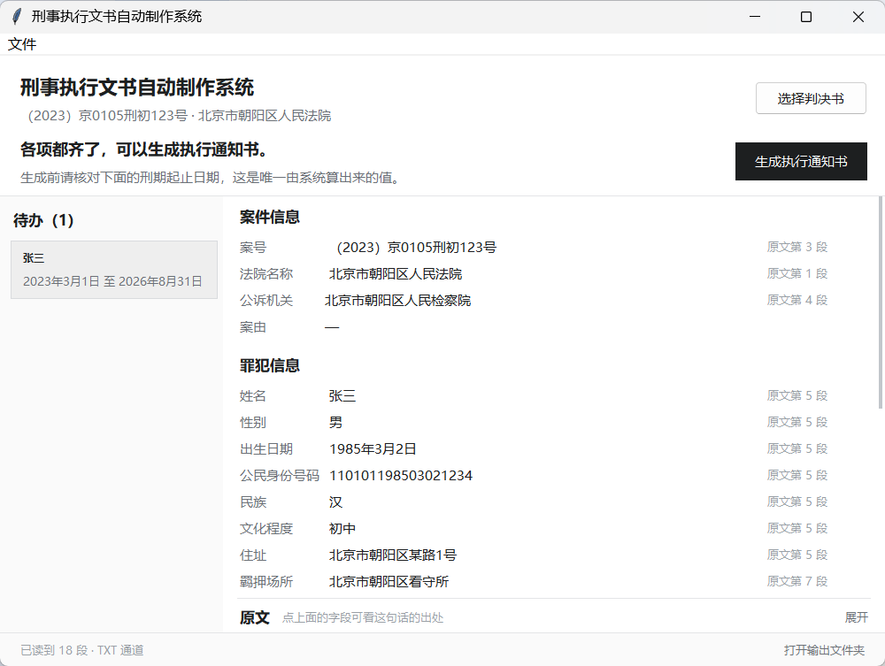

<div align="center">

# CEDAS · 刑事执行文书自动制作系统

**判决书进，执行文书出**

面向法院执行部门的**内网离线**文书生成工具：读判决书 → 抽字段 → 填模板 → 规范命名归档


[项目概览](#1-项目概览) · [系统架构](#2-系统架构) · [功能边界](#3-功能边界v1) · [快速开始](#4-快速开始开发机) · [离线交付](#5-离线交付构建法院内网用) · [数据格式](#6-输入数据格式) · [目录结构](#7-目录结构) · [质量保障](#8-质量保障) · [项目状态](#9-项目状态) · [文档导航](#10-文档导航)

</div>

> 运行环境：法院内网 · 全程离线 · 纯 CPU · 无 GPU · 无 OCR · 运行端不部署任何模型
> 目标机型：Windows 7 / Windows 10，内存按 **2GB** 设计，开发期按 4GB

---

## 1. 项目概览

CEDAS 是一个**离线**的刑事执行文书生成工具。操作人员上传刑事判决书，系统抽取 A/B/C/D 四组字段，按文书类型映射到模板占位符，生成 `.docx` 并规范命名归档，全部数据留在本机。

判决书是高度结构化的法定文书，字段集中在首部、主文、落款三个区域。因此本项目**在运行端不部署任何模型**，主路径为「清洗层 + 规则锚点抽取」，可解释、可回归、零推理开销。轻量模型兜底与本地 LLM 均不在 v1 范围内，判断依据见 [`docs/03-决策记录-ADR.md`](docs/03-决策记录-ADR.md)。

项目不追求"把判决书丢给模型让它自己想办法"，而是把三条硬约束做成工程能力：

| 约束 | 工程实现 |
| :--- | :--- |
| **可解释** | 每个字段来自哪条规则、锚定哪段原文，均可回查；规则库为外部 JSON，强制携带 `evidence` |
| **可回归** | 每条规则配最小测试样本；改 A 字段必须跑全量回归，防止连带破坏 B 字段 |
| **可离线** | 运行端不 import 任何网络库（由 `tests/test_offline_guard.py` 静态断言）；解释器与依赖随包分发，目标机零安装 |

### 1.1 一句话边界

| 项 | 结论 |
| :--- | :--- |
| 抽取方式 | 规则锚点（外部 JSON 配置 + 少量 Python 函数） |
| 输入 | 带文本层的电子版判决书；**开发期以人工提取的 TXT 替代** |
| 输出 | `.docx` 执行文书 + 台账记录 + 归档目录 |
| 部署 | PyInstaller **onedir** 打包，目标机零安装、双击运行、全程离线 |
| 不做什么 | 不做 OCR、不训练模型、不引入独立数据库服务、不调用任何网络接口 |

---

## 2. 系统架构

### 2.1 数据流

```text
判决书 PDF ──┐
             ├─▶ ingest.clean() ──▶ 段落列表 [{page, text, kind}]
判决书 TXT ──┘        │
                      │  （双通道共用同一个清洗层，禁止为 TXT 单写一条）
                      ▼
              extract.locate() ──▶ 三段锚点
                      │             · 首部锚定层（案号 / 法院 / 被告人）
                      │             · 主文锚定层（"判决如下：" 之后）
                      │             · 刑期表述层（"即自…起至…止"）
                      ▼
              规则库（resources/rules/*.json）──▶ 字段字典 Case / Defendant
                      │
                      ├─▶ calc.sentence() ──▶ 刑期计算与折抵校验（纯日期运算）
                      ▼
              render.mapping() ──▶ 占位符上下文 ──▶ docxtpl ──▶ .docx
                      │
                      ▼
              storage ──▶ SQLite 台账 + 规范命名归档
                      │
                      ▼
              ui（Tkinter）──▶ 待办 / 字段与依据 / 原文定位
```

**双通道是一处刻意设计**：生产输入是 PDF，开发期样本是人工全选复制的 TXT。两者必须汇入同一个 `cleaner.clean()`——否则在 TXT 上调准的规则到了真实 PDF 上会失灵。代价是无页码、无字号、无坐标，因此 `page` 允许为 `None`；这条风险已写入架构文档，并把「≥10 份真实 PDF 回归通过」设为阶段 2 的退出门槛。

### 2.2 分层

```text
ui  ──▶  pipeline  ──▶  storage / render / extract  ──▶  ingest / calc  ──▶  domain
```

**依赖方向严格单向向下。** `domain` 不得 import 任何上层模块，`calc` 不得 import `ingest`。违反即视为设计缺陷。

| 层 | 职责 |
| :--- | :--- |
| `domain/` | 数据模型与枚举，零外部依赖，最底层 |
| `calc/` | 中文刑期解析、届满日计算、折抵规则、一致性校验 |
| `ingest/` | TXT / PDF 读取、清洗、段落结构重建 |
| `extract/` | 锚点定位、规则加载与执行、字段字典装配 |
| `render/` | 模板映射、docxtpl 填充、占位符校验 |
| `storage/` | SQLite 台账、规范命名与文件归档 |
| `pipeline.py` | 编排：一份判决书 → 几份文书、叫什么名、缺字段是否阻断 |
| `ui/` | 复核界面：待办、字段与依据、原文定位；不重算任何业务规则 |

### 2.3 字段分组

| 组 | 内容 | 说明 |
| :--- | :--- | :--- |
| **A · 标识与主体** | 案号、法院名称、被告人、性别、出生日期、民族、住址、公民身份号码、强制措施 | 强制措施存为**有序数组**（拘留 → 逮捕），只留最后一段会丢羁押起始日 |
| **B · 定罪与量刑** | 罪名、主刑、附加刑、缓刑及考验期 | 数罪并罚按 `crimes[]` + `merged_sentence` **两级建模**，不能做成标量 |
| **C · 刑期计算** | 羁押起始日、刑期起止日、折抵方式 | 全部标注为**计算值 / 校验值**，不采信文本抽取结果 |
| **D · 程序性字段** | 判决日期、送达日期、生效日期、审判人员、书记员等 | 原需求文档缺失的一组；"生效日期"是执行文书能否填满的关键 |

> C 组的核心是一条容易算错一天的规则：**届满日 = 起算日 + 刑期 − 1 日**。4 年有期徒刑自 2023-01-01 起算，届满日是 2026-12-31，而不是 2027-01-01。详见 ADR-006。

---

## 3. 功能边界（v1）

**做**：判决书文本解析与清洗、A/B/C/D 四组字段抽取、刑期计算与一致性校验、多被告人分别产出字段字典、按文书类型的模板映射、规范命名与归档、台账检索、人工复核与原文定位。

**暂不做**：

| 项 | 原因 |
| :--- | :--- |
| 轻量模型补抽 | 保留 `Extractor` 协议接口，不实现。RexUniNLU 类模型 CPU 模式需 2GB 内存 + torch 数百 MB，与目标机冲突（ADR-001） |
| 规则自动入库 | 人工修正结果仅进候选队列，需人工审查后才入库 |
| 未成年人案件封存 | 涉及独立的封存与查询权限模型，v1 不覆盖 |
| 单位犯罪主体 | 主体字段结构与自然人差异较大，另行建模 |

详见 [`docs/06-路线图与验收标准.md`](docs/06-路线图与验收标准.md)。

---

## 4. 快速开始（开发机）

```bash
# 依赖（开发期）
python -m pip install -e ".[dev]"

# 跑单元测试（当前 206 项）
python -m pytest -q

# 命令行自检：解析刑期
python -m cedas calc "有期徒刑三年六个月"

# 清洗一份样本，输出段落列表（examples/ 内为合成样本，可随仓库分发）
python -m cedas clean "examples/S000__京0105刑初123号.txt"

# 抽取字段并输出带溯源的 JSON
python -m cedas extract "examples/S000__京0105刑初123号.txt"

# 端到端出文书：抽取 → 刑期 → 填充 → 归档 → 台账（合成模板可随仓库生成）
python tools/make_demo_template.py
python -m cedas render "examples/S000__京0105刑初123号.pdf" --date 2026-10-31 --effective-date 2023-05-11

# 现场自检：路径、依赖、可写性、规则数（支持 --json）
python -m cedas doctor

# 启动图形界面
python -m cedas
```

图形界面分三块：左边**待办**（哪名被告人、哪一份还差东西），中间**字段**（值 + 依据，
即「原文第几段」），下方**原文**（点字段即展开并高亮对应段落）。缺失的必填项画成输入框，
在界面上补录即可，不必回去改判决书；重新生成不会覆盖旧件，文件名自动带 `v2`、`v3`。



设计取舍、用词表与已知限制见 [`docs/10-界面设计.md`](docs/10-界面设计.md)。

> 运行端**不需要**执行上述任何安装步骤。发行版是打包好的可执行目录。

---

## 5. 离线交付构建（法院内网用）

目标机在内网、不联网，**不能下载任何基础环境**。因此构建在有网的机器上完成，产物自带解释器与全部依赖，目标机零安装。

目标机含 **Windows 7**，而 CPython 3.9 起不再支持 Win7，故解释器锁 **Python 3.8.10**，**打一份包同时覆盖 Win7 与 Win10**。

### 5.1 构建机构成

| 项 | 要求 | 不满足的后果 |
| :--- | :--- | :--- |
| 操作系统 | Windows 64 位 | PyInstaller 不支持交叉编译 |
| Python | python.org 官方 **3.8.10**，必须勾选 `tcl/tk and IDLE` | 精简版无 tkinter，打出的 exe 双击无界面，**且打包阶段不报错** |
| 依赖 | `pip install -r requirements-build-win7.txt` | 该清单版本均为 `pip download --python-version 38` 实测有 cp38 轮子 |
| 环境 | 干净虚拟环境 | PyMuPDF 2.x 周边包（`pymupdf4llm` / `onnxruntime`）会顺着 import 链被拉进来，体积失控 |

### 5.2 两步构建

```bash
# 构建机：Windows 64 位 + python.org 官方 Python 3.8.10（必须含 tcl/tk）
python -m venv .venv-build && .venv-build\Scripts\activate
pip install -r requirements-build-win7.txt

# 1) 前置检查（20 秒内报出全部环境问题，不打包）
python tools\build_offline.py --check-only

# 2) 完整构建：打包 → 冒烟测试 → 生成 zip + SBOM + 校验和
python tools\build_offline.py
```

产物 `dist/release/CEDAS-<version>-win7-win64.zip`，解压到目标机后双击 `CEDAS.exe` 即可运行。

### 5.3 四个必须知道的点

- **必须用完整安装的 Python。** 精简版 / embeddable 版不含 tcl/tk，打出的 exe 双击无界面，且打包阶段不报错。构建脚本已把该检查放在最前面。
- **解释器版本不对会被直接拒绝。** 用 3.11 构建会被闸门拦下，因为那样的包在 Win7 上起不来。仅验证链路时可用 `--allow-unsupported-python`，产物名会标 `-unsupported` 且 SBOM 注明不可交付。
- **用 onedir 而非 onefile。** 法院终端管控常禁止从 `%TEMP%` 执行二进制，而 onefile 每次启动都解压到 `%TEMP%`，表现为双击无反应。详见 ADR-010。
- **规则可现场替换，不必重新打包。** 新规则文件放进 `CEDAS\resources\rules\`（与基线同名即覆盖），重启生效。这使内网最麻烦的「改一条规则要重走一遍拷贝审批」不再成立。

> Win7 机器还需 **KB4490628** 与 **KB2533623** 两个系统补丁；Office 2007 及更早**打不开 `.docx`**，需装兼容包。这两项必须在试运行前逐台确认——"生成成功但打不开"比程序报错更难解释。

完整步骤、现场拦截清单与验收单见 [`docs/07-离线部署与交付.md`](docs/07-离线部署与交付.md)。

---

## 6. 输入数据格式

开发期样本为**人工从 PDF 全选复制**得到的纯文本，不是 PDF 文件。因此：

- 一份判决书一个 `.txt`，UTF-8 编码（兼容 GBK 自动识别），保留原始换行，**不得手工整理、不得删除页眉页脚**。
- 文件命名：`{样本编号}__{案号}.txt`，如 `S001__京0105刑初123号.txt`。样本编号与真值表一一对应。
- 无页码信息 ⇒ 溯源字段 `page` 为 `None`，复核界面显示「段落 N」。PDF 通道接入后自动填充页码。

`data/samples/` 下是 **12 份真实生效判决全文**，用于规则回归（`tests/test_samples.py`，58 项断言）。该目录不入库（见 `SECURITY.md`），新克隆的仓库里只有一份 `README.md` 说明来源与边界，样本用例会 skip 而不是 fail。

`examples/` 下只保留一份**合成基线** `S000`（非真实案件），用于跑通命令、界面演示与 TXT/PDF 双通道回归。它同时提供 `.txt` 与 `.pdf` 两份：PDF 由 `tools/make_sample_pdf.py` 从同一份 TXT 排版生成（A4、页眉、页码、大字号标题、按行宽折行），用来断言"同一份文书走两条通道，清洗结果逐段相同"。真实判决是数据库导出的已分段文本，没有软换行与页眉页码，测不到清洗层，所以这份基线不能删。

> 采集样本后务必跑 `python tools/sample_lint.py data/samples`：它会重点识别"被手工整理过"的样本。整理过的样本会让清洗规则假通过，这个坑必须在这一步堵住。来源不同判据不同——数据库导出用默认 `--source db`，PDF 全选复制用 `--source pdf`。

完整规范见 [`docs/04-样本格式与标注规范.md`](docs/04-样本格式与标注规范.md)。

---

## 7. 目录结构

```text
.
├── src/cedas/                 # 主包（src layout，禁止在仓库根目录放业务代码）
│   ├── domain/                # 数据模型与枚举，无外部依赖，最底层
│   ├── ingest/                # 输入层：TXT/PDF 读取、清洗、段落重建
│   ├── extract/               # 抽取层：锚点定位、规则注册、字段字典装配
│   ├── calc/                  # 计算层：中文刑期解析、折抵、一致性校验
│   ├── render/                # 渲染层：模板映射、docxtpl 填充、占位符校验
│   ├── storage/               # 存储层：SQLite 台账、文件归档
│   ├── pipeline.py            # 端到端：判决书 → 文书，唯一知道命名与归档的地方
│   └── ui/                    # 表现层：主窗口、字段表、原文面板、视图模型
├── packaging/                 # 打包配置（PyInstaller spec 与入口薄壳）
├── tests/                     # 单元测试与回归夹具（206 项）
├── resources/rules/           # 规则库（外部 JSON，可热替换，不随程序版本锁定）
├── resources/templates/       # 文书模板说明（模板原件不入库）
├── tools/                     # 开发工具脚本（建表、样本体检、离线打包）
├── docs/                      # 规格、架构、决策、交接文档
│   └── journal/               # 项目过程记录（按日期）
├── data/                      # 运行数据（除 public-corpus 外均已 gitignore）
│   └── public-corpus/         # 36 份公开判决书主文，刑期计算的回归金标准
└── .github/workflows/         # CI：lint + test（含敏感数据守门）
```

---

## 8. 质量保障

```bash
python -m pytest -q                      # 206 项单元测试
python -m ruff check src tests tools packaging   # 静态检查，零告警
python tools/sample_lint.py data/samples # 样本体检（数据库导出，默认 --source db）
python tools/sample_lint.py examples --source pdf --min-chars 300  # 合成基线：查版式，不查字数
python tools/sample_report.py data/samples        # 批量抽取摘要，采集后逐份回原文核对
python tools/build_offline.py --check-only       # 构建环境闸门
```

| 保障项 | 机制 |
| :--- | :--- |
| 单元测试 | **206 项**，覆盖清洗、PDF/TXT 双通道一致性、刑期解析、真实文书回归、A/B/D 组抽取、渲染、归档、台账、界面文案与状态判定 |
| 静态检查 | `ruff`，`select = E/F/W/I/N/UP/B/SIM/RUF`，零告警 |
| 离线守门 | `tests/test_offline_guard.py` **静态断言**运行端无网络导入——把"不联网"变成可执行断言，而非文档承诺 |
| 双通道一致性 | 同一份合成样本同时以 `.txt` 与 `.pdf` 入库，断言两条通道的段落文本、段落类型逐条相同——把 ADR-005 从文档承诺变成测试 |
| 真实文书回归 | 36 份公开判决书主文中，17 份载明了刑期起止日；复算与载明值吻合 16 份，唯一例外为法定羁押折减。把「刑期算得对」变成可复跑的断言 |
| 端到端出文 | 合成判决书 → 执行通知书，断言正文含刑期起止、落款日期、书记员，且**无残留占位符**；重跑自动升版本不覆盖旧件 |
| 界面文案 | `ui/review.py` 是纯函数层（不 import tkinter），29 项测试锁住「待补充」「只差公民身份号码」这类句子与状态判定；错误码不得出现在屏幕上 |
| 3.8 兼容守门 | `ast.parse(feature_version=(3,8))` + 运行时 API 黑名单。CI 矩阵跑 3.9/3.11，本地守门覆盖 3.8 差异 |
| 敏感数据守门 | CI 拒绝 `data/`、`*.docx`、`*.xlsx`、`*.zip` 进入版本库 |
| 打包冒烟测试 | 产物内跑 `cedas-cli doctor --json`，校验 `ok` / `rule_count` / `frozen` |

### 8.1 代码规模

| 指标 | 数值 |
| :--- | ---: |
| 源码行数 | 6,086（`src/cedas/`，34 个模块） |
| 测试行数 | 2,216 |
| 工具脚本行数 | 1,975 |
| 规则文件 | 2（`head_case_no.v1` / `head_court_name.v1`） |
| 文档 | 10 篇规格 + 过程记录 |

---

## 9. 项目状态

| 模块 | 状态 | 说明 |
| :--- | :---: | :--- |
| `domain/` | ✅ 完成 | 数据模型与枚举已定稿，对应字段字典 v0.1 |
| `calc/` | ✅ 完成 | 刑期解析、届满日、折抵、一致性校验 |
| `ingest/txt_reader` | ✅ 完成 | 编码自动识别、换行归一 |
| `ingest/pdf_reader` | 🟡 合成 PDF 已回归 | 页码 / 字号 / bbox 齐备，与 TXT 通道逐段一致；**未经真实判决书 PDF 验证** |
| `ingest/cleaner` | 🟡 可用待打磨 | 软换行、日期拼接、页眉页脚、规范化已实现；**未经真实样本验证** |
| `extract/` | 🟡 A/B/D 组已实现 | 案号、法院走规则库；身份/罪名/刑期/罚金、判决日期/审判组织/书记员/公诉机关已抽取；附加刑全谱、缓刑考验期待补 |
| `render/` | ✅ 完成 | 映射表两层加载、模板查找、严格占位符校验、渲染封装 |
| `storage/` | ✅ 完成 | 归档命名（非法字符/保留名/路径超长/版本号）与 SQLite 台账 |
| `pipeline.py` | ✅ 完成 | 一条命令串起抽取 → 刑期 → 填充 → 归档 → 台账 |
| `ui/` | 🟡 可用，未上真机 | 待办 / 字段与依据 / 原文定位 / 原地补录已接通 `pipeline`；**未在 Win7 1024×768 实机校字号** |
| 离线交付 | ✅ 链路验证通过 | 87.5 MB / 1020 文件 / zip 46.3 MB；**交付包需用 3.8.10 重打** |

> **已运行验证**：206 项单元测试全绿、`ruff` 零告警、打包冒烟测试通过、36 份真实判决主文的刑期回归、
> 合成模板端到端出文并通过归档与台账、界面在 1000×690 下逐状态截图核对。
> **未验证**：清洗命中率、身份字段命中率、**法院真实模板的占位符兼容性**、目标机（Win7 2GB）实机耗时与字号。
> **不要把"测试通过"当成"功能可用"。**
> 当前唯一的硬阻塞是需要 **20–50 份样本 TXT + 逐份人工真值**；只有 PDF 没有真值，"命中率 ≥98%" 这个指标无法计算。

---

## 10. 文档导航

| 文档 | 用途 | 状态 |
| :--- | :--- | :--- |
| [`00-字段字典-spec-v0.1.md`](docs/00-字段字典-spec-v0.1.md) | 四组字段定义、数据结构、校验规则 | 草案，待业务确认 |
| [`01-需求与可行性评估.md`](docs/01-需求与可行性评估.md) | 原始需求 + 审计结论 + 已修正缺陷 | 已定稿 |
| [`02-系统架构.md`](docs/02-系统架构.md) | 分层、数据流、接口契约、路径模型 | 已定稿 |
| [`03-决策记录-ADR.md`](docs/03-决策记录-ADR.md) | 关键技术决策与理由（ADR-001 ~ 016） | 持续追加 |
| [`04-样本格式与标注规范.md`](docs/04-样本格式与标注规范.md) | 样本采集与真值填写规则 | 已定稿 |
| [`05-开发与交接手册.md`](docs/05-开发与交接手册.md) | **接手必读**：当前状态、下一步、踩过的坑 | 持续更新 |
| [`06-路线图与验收标准.md`](docs/06-路线图与验收标准.md) | 垂直切片定义与量化验收 | 已定稿 |
| [`07-离线部署与交付.md`](docs/07-离线部署与交付.md) | **实施必读**：内网离线构建、现场拦截清单、验收单 | 已定稿 |
| [`08-公开语料与计算回归.md`](docs/08-公开语料与计算回归.md) | 36 份真实判决主文的刑期回归、真实写法形态、待确认口径 | 已定稿 |
| [`09-端到端渲染与归档.md`](docs/09-端到端渲染与归档.md) | 一条链路：阻断码、起算日来源、归档版本、合成模板 | 已定稿 |
| [`10-界面设计.md`](docs/10-界面设计.md) | 界面取舍、用词表、与 pipeline 的三处接口、已知限制 | 已定稿 |
| [`11-文件命名规范.md`](docs/11-文件命名规范.md) | 源文件与输出文书的命名规则、改名边界、缺项处理 | 已定稿 |
| [`12-样本族与覆盖场景.md`](docs/12-样本族与覆盖场景.md) | 12 份真实判决各覆盖什么、四种并罚形态、真实缺陷记录、未覆盖情形清单 | 已定稿 |
| [`journal/`](docs/journal/) | 每次工作会话的过程记录 | 追加式 |

---

## 11. 交给下一个 Agent

先读 [`docs/05-开发与交接手册.md`](docs/05-开发与交接手册.md)，它会告诉你：当前完成到哪一步、哪些是**已验证**、哪些是**假设未验证**、下一个动作是什么。

七条不能碰的红线：

1. 不得在运行端引入任何模型（ADR-001、ADR-008）。
2. 不得为 TXT 单独写清洗逻辑（ADR-005）——两条通道必须共用 `cleaner.clean()`。
3. 不得硬编码样本特征——具体案号、具体日期、具体姓名不得出现在正则里。
4. 不得把敏感数据提交进仓库。提交前必看 `git status`。
5. 不得静默降级——规则版本不匹配、占位符未解析，一律报错，不许猜。
6. 不得让 `calc` 依赖 `ingest`，`domain` 不得依赖第三方库。
7. 不得在目标机不支持的解释器上出交付包（`build_offline.py --target` 已强制）。

过程记录按日期在 [`docs/journal/`](docs/journal/)，可按需回溯决策经过。

---

## 12. 许可证与合规

本项目为法院内部使用软件，**不对外分发**（见 [`LICENSE`](LICENSE)）。

**第三方许可注意**：PyMuPDF 采用 **AGPL-3.0**。院内自用不构成分发，不触发开源义务；若后续向其他单位复制交付，须开源本项目或购买 PyMuPDF 商业许可。此事已记入 ADR-004，属交付前必须复核项。

**数据安全**：`data/` 目录含真实案件材料，已被 `.gitignore` 排除。禁止将任何样本、真值、生成文书提交至版本库或外部服务。详见 [`SECURITY.md`](SECURITY.md)。

---

<div align="center">

**CEDAS · 让每一份执行文书都从判决书里长出来**

</div>
