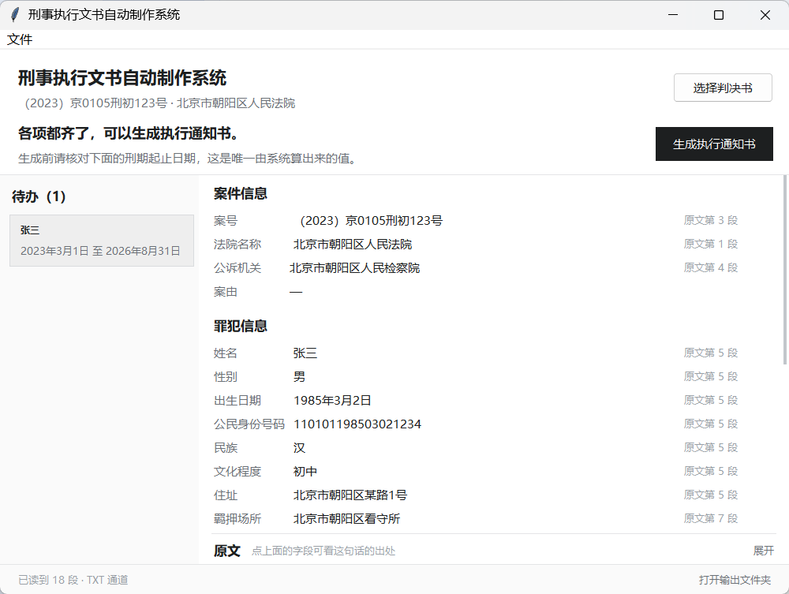

# 界面设计与实现

> 最后更新：2026-10-31 · 对应代码 `src/cedas/ui/`

界面只做一件事：**把「判决书里读到了什么」摆到人眼前，让人确认后出文书。**

书记员一次处理一份判决书，最怕两件事：漏看一份被卡住的、以及把错值当成对的。
整个界面围绕这两件事组织：左边是「哪份还差东西」，右边是「这个值从原文哪一句来的」。



---

## 1. 为什么是这个样子

参考了两份前端设计规范（pbakaus/impeccable 与 Leonxlnx/taste-skill）后，方向反而被压窄了：
impeccable 把界面分成 Persuade / Operate / Read / Experience 四类，其中 **Operate 模式
的「野心表现为精确与克制，用户已经熟悉的模式值得保留，工具的失败不是平淡，而是没有理由的陌生」**
直接适用。taste-skill 的工作界面规范也明确放开低调边框、小标签与重复面板。

结论是：这类软件不该被「设计」得更漂亮，而该被「设计」得更少。下面每一条取舍都能落到
「书记员少犯错」上，而不是「看起来更现代」。

| 取舍 | 理由 |
| :--- | :--- |
| 待办按「待补充」排在前面 | 一次处理五到十份时，漏看一份阻断的代价最高 |
| 缺失字段才画成输入框 | 已填字段全框起来，整屏就像一张待填表单，反而看不出哪里真缺 |
| 一个对象最多一处强调色 | 一行里同时出现三处红（标签、字段、整行底色）等于没有信号 |
| 「依据」写「原文第 6 段」 | TXT 通道没有页码（ADR-005 的能力降级），界面必须两种通道都成立 |
| 单窗口上下分栏，不做三栏 | 1024×768 减去任务栏只剩 728px，三栏一挤字段名就被截断 |
| 原文面板默认收起、点字段才展开 | 字段有 22 项，原文常驻会把字段区压到只剩十行 |

---

## 2. 尺寸、字体与颜色

| 项 | 取值 | 说明 |
| :--- | :--- | :--- |
| 窗口 | 1000×690，最小 880×600 | 1024×768 屏幕留出任务栏与标题栏 |
| 左栏 | 固定 252px | 再窄卡片里的刑期起止会换行 |
| 字体 | 微软雅黑 9/10/11/13 pt | Win7 起自带；宋体在 Tk 里渲染发虚 |
| 字号阶梯 | 12/13/15/17px 四档 | 只差 1–2px，靠字重与颜色分层，不靠字号喊 |
| 主按钮 | 近黑 `#1d1f20` | 蓝色在 Win7 Aero 下会和系统高亮色打架 |
| 待补充 | 浅琥珀底 `#fffbeb` + 深琥珀字 `#92400e` | 全屏唯一的彩色 |
| 可生成 / 已生成 | 浅绿 / 浅蓝底 + 深字 | 同一套浅底深字的规则 |

`ttk.Style().theme_use("vista")` 保证 Win7 与 Win10 都是原生外观；样式集中在
`ui/theme.py`，改配色只动这一个文件。

**字号单位是 pt 不是 px**（Tk 的限制），`10pt ≈ 13.3px` 不是整数对应，实际渲染会有
1px 级偏差。上线前需在真机按像素再校一次。

---

## 3. 三块内容的规则

### 3.1 左栏：待办

一名被告人一行，两行文字加一个状态标签：姓名、刑期起止、`待补充`/`可生成`/`已生成`。

- **待补充排在最前**，排序键是 `(是否阻断, 序号)`。
- 一行里只出现一处彩色标签，不再整行染红底。
- 阻断原因在结论句里说清楚，卡片上只留状态词——卡片太窄，写不下「还差 2 项：缺身份证号、缺出生日期」。

### 3.2 右侧：字段表

四组，22 项：案件信息 → 罪犯信息 → 量刑与刑期 → 程序。

每行三列：`名称 | 值 | 依据`。

- **值**：必填缺失显示「未录入」并画成输入框；选填为空显示「—」；
  生效日期这类「不填有后果」的显示「未录入 · 不填则文书中该处留空」。
- **依据**：显示「原文第 N 段」；计算值（刑期、届满日）没有依据，留空。
- **点行**：下方原文面板展开并高亮该段；计算值点开会提示「这一项是系统算出来的」。
- **双击值**：原地变成输入框，回车提交、Esc 取消。日期接受 `2023-5-21`、
  `2023年5月21日`、`2023/5/21` 三种写法，不要求补零。

补录写回 `FieldValue.correct()`，原值进 `corrections` 留痕；起算日不存在于任何
`FieldValue`，单独存成 `start_dates[seq]` 传给 `pipeline.generate`。

### 3.3 下方：原文面板

`Text` + tag 高亮，不启动任何外部程序（ADR-003、ADR-007）。默认收起，
标题条上一行字说明「点上面的字段可看这句话的出处」，右侧有「展开/收起」。

内容随导入时的一次清洗结果铺进去，段号从 1 开始，与「原文第 N 段」对齐。

---

## 4. 用词：屏幕上不出现技术词

| 系统内部 | 界面 |
| :--- | :--- |
| 阻断 / blocker | 待补充 |
| 队列 | 待办 |
| 抽取值 | （不写标题，直接显示值） |
| `Provenance.paragraph_index` | 依据：原文第 6 段 |
| `start_source = "羁押起始日"` | 按 3 月 1 日拘留起算 |
| `E-EFFECTIVE-DATE` | 输入框 + 占位符「填写日期，如 2023-05-12」 |
| A 组 / B 组 / C 组 / D 组 | 案件信息 / 罪犯信息 / 量刑与刑期 / 程序 |

**错误码不进界面**：阻断码到人话的映射集中在 `ui/review.py:BLOCKER_HINTS`，
按码查句、不解析中文；认不出的码回落为「有必填项没填」，绝不把码漏到屏幕上。

---

## 5. 与 pipeline 的接口只有三处

界面不重算任何业务规则：阻断判定在 `pipeline.check_blockers`，
界面只负责翻译成人话。两边各算一次，迟早会不一致。

```text
选完文件   prepare(path)                     读文件 + 抽字段，不落盘
改任何值   plan(document, start_dates=…)     只算「能出什么、卡在哪」，不落盘
点生成     generate(prepared=document, …)    落盘 + 归档 + 台账
```

`prepare` 与 `plan` 拆开是为了老机器：解析一份判决书是秒级开销，
每改一个生效日期就重读一遍 PDF，用起来会明显卡。现在改日期只重跑 `plan`。

`plan(require_template=False)` 让「模板还没放好」也能打开复核界面——
否则用户连缺哪个字段都看不到，只知道程序报错。

---

## 6. 刻意不做的事

| 不做 | 原因 |
| :--- | :--- |
| 拖拽导入 | Tk 要装 `tkdnd`，Win7 兼容差，内网补不了依赖；用文件对话框 |
| 多文件批次队列 | 一次一份与「审完一份出一份」的节奏一致；跨案批量补录要想清楚再做 |
| 三栏并列（队列/字段/原文） | 1024×768 放不下 |
| 界面内计算刑期 | 规则只有一份，在 `calc` 层 |
| 表格内联编辑全部字段 | 罪名是列表、主刑是枚举，就地编辑会引入校验分支；这些留在字段表外 |

---

## 7. 已知限制

1. **未在 Win7 真机验证**。布局按 1024×768 设计，但 Win7 的字体度量与 DPI 行为需实测。
2. **DPI 缩放**：Tk 不做 DPI 感知，125% 缩放下由系统拉伸（比例正确、略糊）。
   若后续要做 per-monitor DPI，需同时缩放所有 padx/pady，改动面大。
3. **多被告人只能逐个生成**：`generate` 一次处理全部被告人，人工指定的起算日
   通过 `start_dates[seq]` 逐人给，但界面目前一次点「生成」出全部文书。
4. **没有历史列表**：台账里的历史文书只能在输出目录里找。二期的入口应放在状态栏。
5. **原文面板不支持反向定位**（点原文段落跳到字段），只做了字段 → 原文。

---

## 8. 怎么核对版式

像素问题（滚动条被挤出窗口、文字被面板切一半、栏宽被内容撑开）单元测试测不到，
只有渲染出来才看得见。用 `tools/ui_screenshot.py`：

```bash
py -3.12 tools/ui_screenshot.py empty     # 首次打开的空状态
py -3.12 tools/ui_screenshot.py loaded    # 导入合成判决书后的主界面
py -3.12 tools/ui_screenshot.py blocked   # 人为抹掉身份证号，看「待补充」
py -3.12 tools/ui_screenshot.py locate    # 点字段后原文展开与高亮
```

需要一个带 `tkinter` 与 `Pillow` 的解释器（工程机上是 3.12，默认的 3.13 无 tkinter）。
脚本会把进程设为 DPI 感知并把 tk scaling 固定为 96dpi，否则 125% 缩放的机器上
抓出来的图会被裁掉右半边。

`ui/review.py` 是纯函数层，不 import tkinter，文案与状态判定由
`tests/test_ui_review.py`（29 项）覆盖。
