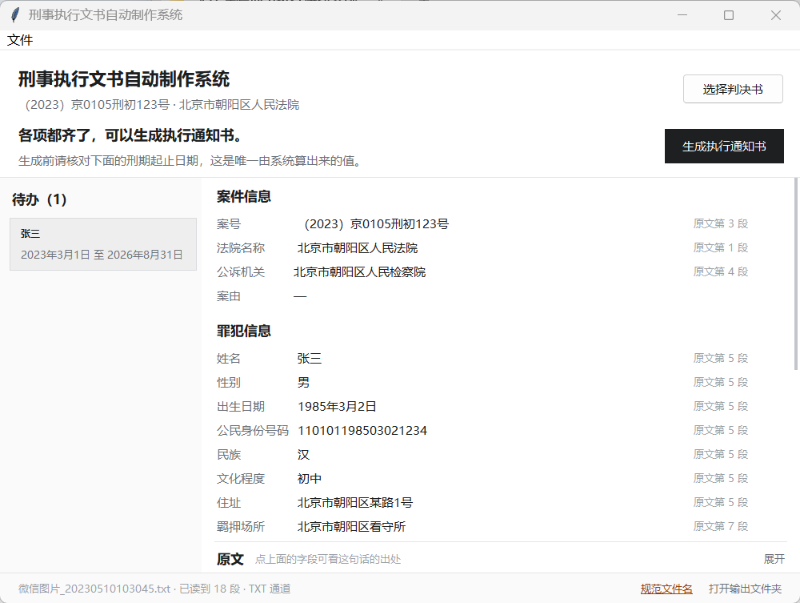

# 文件命名规范

一份判决书进系统，两份东西出系统：**改过名的判决书**和**新生成的执行文书**。
本文件规定这两者的名字，以及为什么这么定。

命名不是排版问题。法院找卷宗的动作永远只有三种——报案号、报被告人姓名、看日期。
文件名承载这三样，就能按名称排序直接找到；不承载，就只能一份份点开看。
现场交来的 PDF 十有八九叫「扫描件001.pdf」或「微信图片_20230510103045.pdf」，
这两个名字里的信息量是零。

## 1. 一条规则，两处使用

```
案号_当事人_文书类型_日期[_vN].扩展名
```

| 场景 | 例子 |
| :--- | :--- |
| 源文件（判决书） | `（2023）京0105刑初123号_张三等3人_刑事判决书_20230501.pdf` |
| 输出（执行通知书） | `（2023）京0105刑初123号_张三_执行通知书_20230501_v2.docx` |

两处共用 `src/cedas/storage/naming.py` 里同一段代码。分开写两份规则，
半年后必然出现「判决书名里带法院、通知书里不带」这种没人说得清的差异。

### 1.1 各段怎么取

| 段 | 取值 | 缺失时 |
| :--- | :--- | :--- |
| 案号 | 正文首部案号行，如 `（2023）京0105刑初123号` | **中止改名**（见 §3） |
| 当事人 | 第一被告人姓名；多人时 `张三等3人` | 跳过该段，提示补录 |
| 文书类型 | 由正文识别：`刑事判决书` / `刑事附带民事判决书` / `刑事裁定书` / `刑事起诉书` | 跳过该段 |
| 日期 | 源文件取**判决日期**（落款），输出取**文书落款日期** | 跳过该段 |
| 版本 | 只在与已有文件重名时出现，`v2`、`v3` | — |

三个取舍值得说明：

- **当事人不写全名单。** 五名被告人的名字写进文件名，案号会被挤出去，
  而找卷宗的人先想到的是案号。人数比名单更有用：一眼看出这案要不要分开出文。
- **缺项跳过，不写「未识别」。** 占位符会被检索当成关键词，还会让人误以为名字已定稿。
  缺什么由界面/命令行单独报出来，补录之后重算名字即可。
- **版本号放末尾。** `v2` 夹在类型与日期中间（`..._v2_执行通知书_20230501`）会让
  同案同人的不同版本排不到一起，而「找最新一版」恰恰是复查时最常做的事。

### 1.2 字符与长度

- Windows 非法字符 `\ / : * ? " < > |` 一律换成 `-`；空白全部去掉。
- 全角括号 `（）` 保留：Windows 允许，也是法院写案号的习惯。
- 各段有独立长度预算：案号 40 字、当事人 20 字、类型 20 字。
  真实案号最长约 22 字，40 字足够；超长案号会被截断（罕见，且截断后仍可检索）。
- 整条路径超过 250 字符直接报错，不静默截断——截断后的名字可能撞车。

## 2. 源文件：什么时候改名

```
识别正文  →  算出规范名  →  摆给人看  →  确认后改名
```

改名是**唯一会动用户磁盘上已有文件**的动作，所以默认不做，必须由人触发：

| 入口 | 动作 |
| :--- | :--- |
| 界面状态栏右侧「规范文件名」 | 弹确认框（原名 → 新名），确认后改名 |
| 菜单「文件 → 按识别结果重命名判决书…」 | 同上 |
| `cedas rename 文件.pdf` | 只打印原名与新名，**不动文件** |
| `cedas rename --apply 文件.pdf` | 真正改名 |



名字已经规范时这个入口不出现——常驻一个用不上的按钮只是噪音。
状态栏左侧始终显示当前文件名：现场一个文件夹里躺着七八份「扫描件00x.pdf」，
不写清楚现在读的是哪一份，复核完才发现看错了文件。

```bash
# 先看清楚会改成什么
cedas rename 桌面/扫描件001.pdf

# 一个文件夹里的扫描件批量规范
cedas rename --apply D:/待整理/*.pdf
```

改名的时机也重要：界面里如果案号、判决日期是人工补录进去的，
规范名会跟着变——**先补录，再改名**，否则要改两次。确认框里会提示名字里还缺哪几段。

### 2.1 三条不改的情形

1. **案号没认出来。** 案号是检索主键。此时改出一个「无案号」的名字，
   等补录完还得再改一次，中间那段时间的名字反而误导人。界面会说「还改不了文件名」。
2. **目标位置已有一份内容完全相同的文件。** 同一份判决书留两份，日后分不清哪份是底稿。
   只报告，不改名，也不删——留给人决定。（判据是 SHA-256 而不是文件大小：
   同一天扫的两份文书页数一样、大小一样，内容却不同。）
3. **文件正被占用。** PDF 阅读器打开着就改不了，报「请先关闭」。

### 2.2 撞名怎么办

同一案号、同一当事人、同一日期，理论上不该有两份判决书。真撞上时（重扫、换版本），
**加 `_v2` 而不是覆盖**。改名只在原目录内进行，不跨盘搬动，不复制。

## 3. 输出文书：名字与目录

```
data/output/{案号}/{被告人}/{案号}_{被告人}_{文书类型}_{日期}[_vN].docx
```

目录按「案号 → 被告人」两级，是**案卷的结构**而不是程序的结构：
一个案子一个文件夹，一个人一个子文件夹，开庭前打印、结案后归档都按这个层级走。

重新生成不覆盖已签发的文书：`next_version` 探测到同名文件就升版，
台账 `documents` 表按 `(defendant_id, doc_type, version)` 唯一约束记录，
文件与台账靠 `sha256` 对应——文件被人挪走或改过，一比对就知道。

## 4. 与台账的关系

台账记的是**输出文书**的相对路径与版本，源文件只在会话中处理，不入库。
原因：源文件通常在桌面、下载目录或某个临时文件夹里，路径不稳；
把它抄进台账只会得到一条很快失效的记录。
要长期保存判决书，请把它归档到案卷目录，那是档案管理的职责，不是本程序的。

## 5. 已知限制

| 限制 | 说明 |
| :--- | :--- |
| 不改扩展名 | 沿用原文件扩展名；原文件没有扩展名时才补 `.pdf` |
| 不搬目录 | 改名只换名字，不动位置。想整理目录请用资源管理器 |
| 不写台账 | 改名是文件系统操作，不进台账；台账只记生成文书 |
| 同名上限 99 | 同一目录里同名到 99 次会拒绝，提示先整理文件夹 |
| 文书类型认不出时留空 | 宁缺不猜：把起诉书标成判决书比留空更糟 |

## 6. 相关代码与测试

| 位置 | 内容 |
| :--- | :--- |
| `src/cedas/storage/naming.py` | 命名规则、改名方案与执行（纯函数 + 一次 `rename`） |
| `src/cedas/storage/archive.py` | 归档目录、路径长度、版本探测 |
| `src/cedas/extract/doc_type.py` | 文书类型识别（标题行 → 主文转向句 → 起诉语） |
| `src/cedas/ui/review.py` | `rename_prompt`：把方案翻成界面用语 |
| `tests/test_naming.py` | 25 项：拼名、缺项、撞名、重复、幂等、真实改名、识别、界面用语 |
